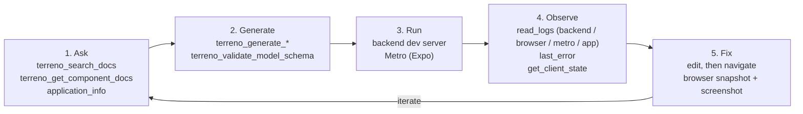

# AI development loop

A coding agent working on a Terreno app runs the same five-stage loop on every change:
it asks how something should be done, generates the code, runs the app, observes what the
app did, and fixes what it finds. Terreno's two MCP servers supply a tool for each stage.

- **`terreno-mcp`** is the hosted server. It holds the docs, the code generators, and the
  convention validators. It knows Terreno but not your app.
- **`terreno-mcp-local`** runs in your project over stdio. It reads your app's logs,
  client state, and database, and drives the running app. It knows your app but not the
  docs.

This page covers what the agent can see and do at each stage, and where that stops. How
Terreno's conventions reach the agent in the first place is in
[Agent guidelines](agent-guidelines.md).

## The five stages

### 1. Ask

The agent looks up the current way to do something before it writes code.

| Tool | Server | Contributes |
| --- | --- | --- |
| `application_info` | local | The app's `@terreno/*`, Expo, React Native, and Mongoose versions, so later answers match the installed release |
| `terreno_search_docs` | hosted | BM25 search over the bundled docs, several queries per call, filtered by package and lockstep `version` |
| `terreno_get_component_docs` | hosted | The full props table for one `@terreno/ui` component |
| `terreno_get_upgrade_guide`, `terreno_search_update_notes`, `terreno_get_update_note`, `terreno_ask_update_help` | hosted | Upgrade notes for a version range, and questions against them |
| `terreno://docs/*` resources | hosted | Fixed entry pages a client can read without a tool call |

Version matters here. An agent that passes the app's version to `terreno_search_docs` gets
the guidance for the release the app is on, not for the newest one.

### 2. Generate

The agent produces code in Terreno's shape instead of inventing it.

| Tool | Server | Contributes |
| --- | --- | --- |
| `terreno_generate_model`, `terreno_generate_route`, `terreno_generate_screen`, `terreno_generate_form_fields` | hosted | A Mongoose model with the standard plugins and types, a `modelRouter` with permissions, an Expo screen, form fields |
| `terreno_validate_model_schema` | hosted | Checks a schema against the conventions, such as a `description` on every field |
| `terreno_validate_ui_blocks` | hosted | Checks an agent reply document against the blocks catalog |
| `terreno_install_admin` | hosted | Admin panel integration snippets |
| `terreno_bootstrap_ai_rules` | hosted | Rule files for the app's editors |

The generators return file contents and instructions. They do not write files, so the agent
stays in control of where code lands. A new app is scaffolded by `create-terreno-app`, not by
an MCP tool.

### 3. Run

The app runs the way a developer runs it: the backend dev server, and Expo's Metro dev
server for the web, simulator, or device build. There is no special agent runtime. The
local server attaches to what is already running.

Two pieces of development-only instrumentation make the running app observable:

- The backend's logger writes JSONL to `.terreno/logs/app.log`. By default this is on
  whenever `NODE_ENV` is not `production`.
- On web, `installTerrenoDevConsoleLogger` (from `@terreno/syncdb`) forwards `console.error`,
  `console.warn`, and uncaught errors and rejections to the backend's `POST /__terreno/browser-logs` route, which writes
  `.terreno/logs/browser.log`. The route exists only in development and is never registered
  in production. See [Development browser-log ingestion](../reference/api.md#development-browser-log-ingestion).

### 4. Observe

The agent reads what the app did.

| Tool | Contributes |
| --- | --- |
| `read_logs` | One merged, time-ordered tail from four sources: `backend` (server JSONL), `browser` (web errors and warnings JSONL), `metro` (bundler events), and `app` (the Hermes console over the Chrome DevTools Protocol). Its `connection` field says which live sources are attached. |
| `last_error` | The newest error-level entry across the same sources, as the raw line. It includes a stack when the entry carries one. |
| `get_client_state` | The client data layer in the running app. It reports which `layer` it found (`rtk`, `syncdb`, both, or `none`) and returns the RTK Query cache and auth state, the SyncDB state, or both. `get_rtk_state` is a deprecated alias. |
| `get_syncdb_state`, `syncdb_snapshot` | SyncDB entities, outbox, conflicts, cursors, and debug events, plus snapshots to compare before and after a change |
| `database_schema`, `database_query` | The app's MongoDB collections and documents, through a read-only allowlist |

All of these are reads. None of them needs an opt-in.

### 5. Fix

The agent edits code in its own editor, then reproduces the path that failed and checks the
result.

| Tool | Contributes |
| --- | --- |
| `navigate` | Moves a native app to an expo-router path over the same CDP connection the logs use |
| `browser` | Drives the web app in a headless WebView: open, click, type, scroll, then `snapshot` the rendered page and save a `screenshot` as proof |
| `evaluate` | Runs a JavaScript expression in the app's Hermes runtime |
| `syncdb_action` | Changes a live SyncDB client: mutate, flush, resync, resolve conflicts, go offline |

`evaluate`, `navigate`, `syncdb_action`, and the `browser` tool's `evaluate` action run code
or change state inside the app, so they refuse unless the local server was started with
`TERRENO_MCP_EVAL=1`. Generated editor configuration never sets it. The other `browser`
actions do not need it.

After the fix, the loop goes back to Observe. A change is done when the logs and state show
the new behavior, not when the edit compiles.

## Tool layer versus process layer

The loop is half of how Terreno works with agents. This page covers the tool layer. The
`/terreno-*` lifecycle skills are the process layer, described in
[Planning plugins](planning-plugins.md).

| Layer | Answers | Delivered by |
| --- | --- | --- |
| **Tool** | What can the agent see and do? | MCP servers: docs search, codegen, merged logs, client state, navigation |
| **Process** | In what order should the agent work, and who checks it? | `/terreno-*`: question-first planning, TDD, fresh-context independent review, evidence gates, reactive review loop |

The two compose. The lifecycle's build and prove stages use the loop's tools to gather their
evidence, and the tools are most useful when the lifecycle decides when to call them.

## What makes this different

The agent observes what the app actually did, not a description of it.

Without these tools, an agent learns about a failure from a person's summary, a pasted stack
trace, or its own guess about what the code should do. With them, it reads the 500 from the
server log, the uncaught error from the browser console, and the cache entry the screen
rendered from. It reads them from the same run it just changed.

The rest is table stakes. Docs search, generators, and rule files exist for other frameworks
too, and Terreno does not claim otherwise.

## What the agent cannot see

The loop ends at the edge of the local development session, and some sources have gaps
inside it.

- **Production.** The backend log file is off in production by default, the browser-log
  route is never registered there, and no tool reads a hosted log service. Production errors
  reach the agent only if a person brings them in.
- **Native crash reports.** A native crash outside the dev loop, such as an iOS crash report
  or an Android tombstone, never reaches the JavaScript console, so no log source carries it.
- **Devices not attached to a dev server.** The `app` source, `navigate`, and `evaluate` reach
  a runtime only through Metro's inspector. A phone running a release build, or one not
  connected to Metro, is invisible.
- **The `app` source on web.** The web build has no Hermes target, so `app` returns nothing
  there. On web, errors, warnings, and uncaught exceptions arrive through the `browser` source
  instead; `console.log` and `console.info` reach no source. `app` needs a native
  development build or Expo Go attached to Metro.
- **Metro events under Expo CLI.** The `metro` source reads Metro's `/events` socket. In Expo
  CLI 57 that socket accepts connections but never sends events, so `metro` stays empty even
  when its status reads connected.
- **The Hermes debugger connection.** The local server holds one CDP session to the app. On a
  default `expo start` with current React Native, that session and React Native DevTools
  coexist. On a target that allows a single debugger, or when Expo runs headless, opening
  DevTools disconnects the local server. The next call that reads the app reconnects and
  disconnects DevTools in turn, and console entries logged in between are lost. The
  `connection` field reports the close reason.
- **Missing stacks.** `last_error` returns the line as it was logged. If the code logged a
  message without a stack, there is no stack to return.

## How this composes

Terreno does not build its own simulator or browser automation. It composes with three tools
that already do it well, and keeps to the part they lack: reading the app's logs, client
state, and data.

| Tool | Use it for | Lives |
| --- | --- | --- |
| `expo-mcp` | Interacting with the iOS simulator or Android emulator: screenshots and taps on the native app | Agent session |
| Playwright MCP | Interacting with the web app in a full browser while working | Agent session |
| Maestro | Flows worth keeping, such as login, signup, and creating a todo, committed and run in CI | Repository |

The division of labor:

- **Interaction is the composed servers' job.** `expo-mcp` and Playwright MCP move the app
  and show what is on screen. Terreno's `browser` tool covers the same ground on web when a
  lightweight headless session is enough.
- **Observation is Terreno's job.** After a tap or a click, `read_logs`, `last_error`, and
  `get_client_state` show what the app did behind the screen.
- **Durability is Maestro's job.** An agent session ends. A flow that proved a fix and should
  keep proving it becomes a Maestro flow, so CI repeats the check on every change.

`create-terreno-app` writes `expo` and `playwright` entries next to the two Terreno servers
in the app's `.cursor/mcp.json` and `.mcp.json`, so a new app starts with all four.

## Related

- [Set up Terreno MCP](../how-to/set-up-terreno-mcp.md): connect the servers to your editor
- [Debug a Terreno app with MCP](../how-to/debug-with-mcp.md): the loop on a real failure
- [MCP server reference](../reference/mcp-server.md): every tool, prompt, resource, and variable
- [Agent guidelines](agent-guidelines.md): how Terreno's conventions reach the agent
- [Planning plugins](planning-plugins.md): the process layer
